<p align="center">
  
</p>

<p align="center">
  <a href="#mulai-lokal">Mulai lokal</a> ·
  <a href="#tahap-pengerjaan">Tahap pengerjaan</a> ·
  <a href="docs/DESIGN.md">Desain</a> ·
  <a href="LICENSE">Lisensi MIT</a>
</p>

Ramu adalah ruang kerja sederhana untuk mentor pembinaan Islam lintas komunitas: menyiapkan bahan, menyusun pertemuan, dan mendampingi diskusi dengan lebih terarah. Proyek ini dikerjakan sebagai final project **Frontend Basic KSM Veterantech**.

**Bank Materi kini berisi enam paket diskusi.** Cari kata dari judul atau ringkasan, pilih kategori, lalu buka paket untuk membaca pertanyaan diskusi dan sumbernya. Contohnya, cari `tabayun` untuk menemukan latihan memeriksa kabar di grup kelas.

## Halaman

| Halaman | Peran dalam Ramu |
| --- | --- |
| [Bank Materi](index.html) | Tempat memilih bahan pembinaan. |
| [Ruang Sesi](sesi.html) | Kerangka empat bagian pertemuan. Editor dan mode pandu direncanakan pada tahap selanjutnya. |
| [Panduan & Sumber](panduan.html) | Penjelasan cara pakai, batas draf, dan prinsip kurasi. |

Tampilan memakai teal gelap, kertas krem, sage, serta aksen emas. Bayangan tipis dan lapisan kertas memberi kesan meja kerja yang tenang. Wordmark teks digunakan sambil menunggu persetujuan logo final.

## Mulai lokal

Clone repository, lalu masuk ke folder proyek.

```bash
git clone https://github.com/yurnszzz/Ramu.git
cd Ramu
```

Untuk meninjau Bank Materi sebelum T02 masuk ke `main`, jalankan `git switch feat/t02-bank-materi` setelah clone.

Buka `index.html` langsung di browser. Untuk menjalankannya melalui HTTP lokal, gunakan Python dari folder proyek.

```bash
python3 -m http.server 8000 --bind 127.0.0.1
```

Buka [localhost:8000](http://localhost:8000). Hentikan server dengan `Ctrl+C`. Nama perintah Python dapat berupa `python` atau `py -3`, mengikuti instalasi di perangkat.

## Teknologi dan batas materi

- **HTML** untuk struktur semantik dan navigasi tiga halaman.
- **CSS biasa** untuk warna, tipografi, flex/grid, state fokus, dan media query.
- **JavaScript native** untuk menyaring array materi, memperbarui jumlah hasil, serta membuka dan menutup detail melalui DOM.

Ramu mengikuti materi FE Basic tanpa framework atau dependensi runtime. Tidak ada backend, akun, database, API data, penyimpanan browser, timer, atau notifikasi.

Pada fitur sesi yang direncanakan, isian hanya hidup di dokumen yang sedang terbuka. Reload atau berpindah halaman dapat menghilangkan draf; Ramu tidak menjanjikan penyimpanan permanen atau sinkronisasi perangkat.

## Struktur proyek

```text
Ramu/
├── index.html          # Bank Materi
├── sesi.html           # Ruang Sesi
├── panduan.html        # Panduan & Sumber
├── assets/
│   ├── css/            # Style bersama untuk ketiga halaman
│   └── js/             # Koleksi materi dan interaksi Bank Materi
├── docs/               # Desain, batas materi, kurasi, dan hasil QA
│   └── assets/         # Aset dokumentasi README
├── planning/           # Kebutuhan produk dan tahap pengerjaan
├── README.md
└── LICENSE
```

Koleksi dan sumber berada di [materi.js](assets/js/materi.js). Fungsi `tampilkanHasil()` pada [bank-materi.js](assets/js/bank-materi.js) membaca kedua filter dan menggambar ulang daftar. Semua bahan dimuat dari file lokal. Tautan rujukan dapat dibuka saat tersedia koneksi internet.

## Tahap pengerjaan

| Tahap | Cakupan | Status |
| --- | --- | --- |
| T01 | Tiga halaman, navigasi, fondasi CSS, dan layout responsif | Digabung ke `main` |
| T02 | Bank Materi: konten bersumber, pencarian, filter, dan detail | Siap direview |
| T03 | Penyusun sesi, template, durasi, dan preview | Direncanakan |
| T04 | Mode pandu, catatan, dan evaluasi sementara | Direncanakan |
| T05 | Pemeriksaan akhir, dokumentasi, dan pembersihan proyek | Direncanakan |

Satu tahap dikerjakan melalui satu branch dan PR. Tahap berikutnya dimulai setelah PR sebelumnya merge. Detail acceptance ada di [daftar tugas](planning/TASKS.md); hasil pemeriksaan aktual dicatat di [QA](docs/QA.md).

## Materi dan lisensi

Ramu tidak membuat hukum agama atau mengklaim tinjauan ulama. Setiap materi yang ditambahkan harus mempunyai rujukan yang dapat diperiksa; lihat [panduan konten](docs/CONTENT_GUIDE.md).

Dikembangkan oleh [Hasan Shofiyyurrahman](https://github.com/yurnszzz). Kode proyek menggunakan [Lisensi MIT](LICENSE). Sumber materi pihak ketiga tetap mengikuti ketentuan dan atribusinya masing-masing.
